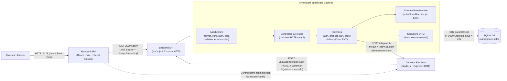
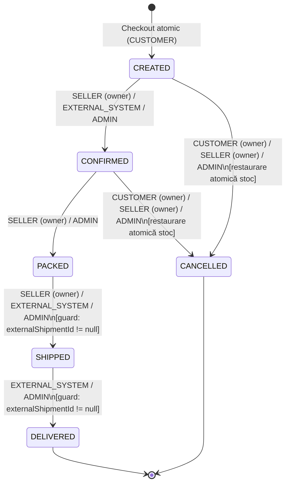
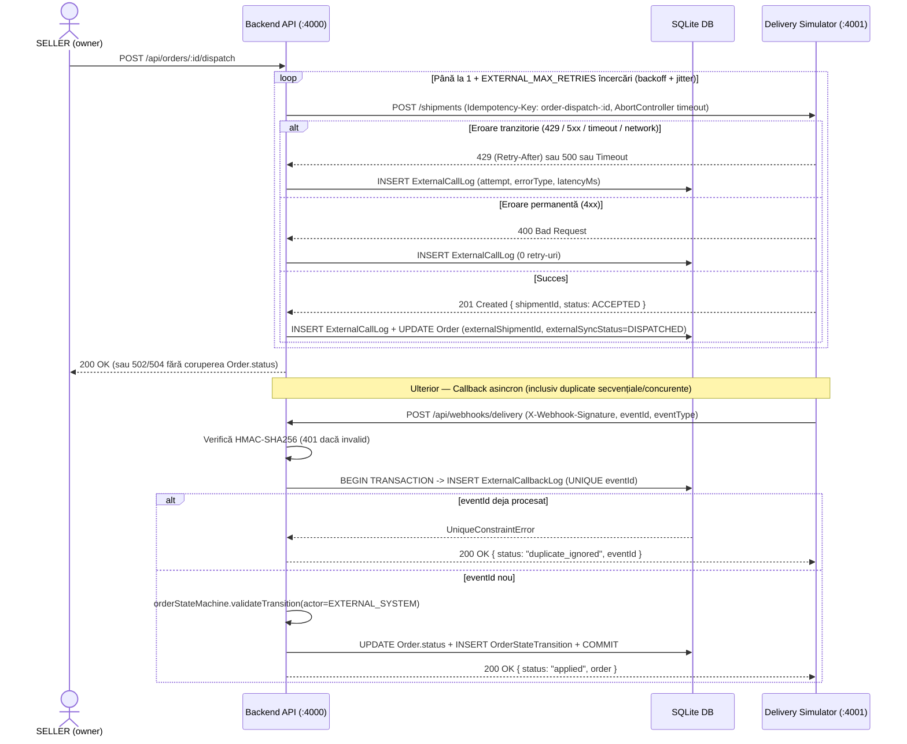
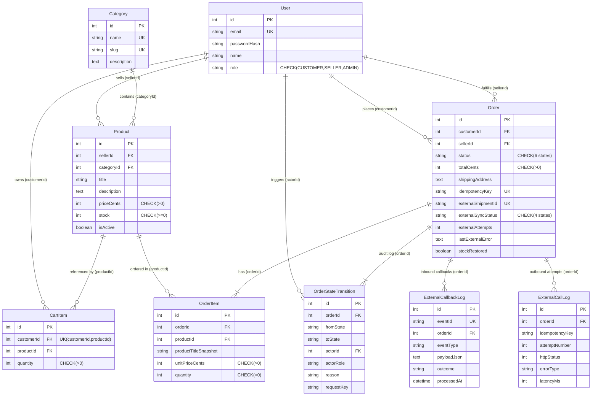

# Arhitectura Sistemului, Schema de Date și Contractul API

> **Proiect:** Marketplace și gestiunea comenzilor (Tema 6 | Pachete: `STA` + `EXT`)  
> **Etapă:** M1 — Analiză și Design  
> **Sursă de adevăr:** [SPEC.md](../SPEC.md)

---

## 1. Vedere de ansamblu (Arhitectura componentelor)

Aplicația este structurată ca un monorepo JavaScript ESM cu 3 componente runtime independente (pornite local, fără dependențe cloud):



### Responsabilitățile straturilor Backend
- **`routes/` & `controllers/`:** Parsează parametrii HTTP, aplică middleware-urile de autentificare/rol/validare și delegă logica către `services/`. Nu conțin reguli de business sau interogări SQL directe.
- **`middleware/`:** `authenticate` (verificare JWT), `authorizeRoles` (RBAC), `validate` (validare strictă payload/query), `errorHandler` (serializare unitară a `AppError` fără a expune stack trace-uri).
- **`domain/orderStateMachine.js` (`STA`):** Modul pur, fără dependențe de Express/HTTP, care definește stările, tranzițiile permise, actorii autorizați și precondițiile (guards).
- **`services/`:** Orchestrează tranzacțiile Sequelize, verificările de ownership pe obiect, apelurile outbound reziliente (`deliveryClient.js` — `EXT`) și deduplicarea webhook-urilor.
- **`models/`:** Modelele Sequelize, asocierile, indexurile și constrângerile SQL reale (`NOT NULL`, `UNIQUE`, `CHECK`, `FOREIGN KEY`).

---

## 2. Diagrama fluxurilor cheie (`STA` și `EXT`)

### 2.1 Mașina de stări a comenzii (`STA`)



### 2.2 Secvența integrării externe reziliente (`EXT`)



---

## 3. Modelul de date relațional (ER Diagram & Constrângeri)

SQLite rulează obligatoriu cu `PRAGMA foreign_keys = ON;` activat pe fiecare conexiune în `backend/src/config/database.js`. Toate valorile monetare sunt stocate ca întregi în bani/cenți (`priceCents`, `unitPriceCents`, `totalCents`) pentru a elimina erorile de virgulă mobilă.



### Indexuri și constrângeri de integritate cheie
- **`Product`:** indexuri pe `categoryId`, `sellerId`, `priceCents`, `isActive` (pentru filtrarea/ordonarea eficientă a catalogului); `CHECK(priceCents > 0)`, `CHECK(stock >= 0)`.
- **`CartItem`:** `UNIQUE(customerId, productId)`, `ON DELETE CASCADE` la `User` și `Product`, `CHECK(quantity > 0)`.
- **`Order`:** indexuri pe `customerId`, `sellerId`, `status`, `createdAt`; `UNIQUE(idempotencyKey)` (cu suport pentru chei derivate `${clientKey}:seller:${sellerId}` la checkout multi-vânzător); `UNIQUE(externalShipmentId)`; `CHECK` pe `status`, `externalSyncStatus` și `totalCents > 0`.
- **`ExternalCallbackLog`:** `UNIQUE(eventId)` — garanția de bază împotriva procesării duplicate (inclusiv concurente).
- **`OrderStateTransition`:** `ON DELETE CASCADE` la `Order`, `actorId` nullable (este `null` când `actorRole === 'EXTERNAL_SYSTEM'`).

---

## 4. Contractul API REST

### 4.1 Format standard de eroare

Toate răspunsurile de eroare (`4xx` și `5xx`) respectă structura unică:

```json
{
  "error": {
    "code": "VALIDATION_ERROR",
    "message": "Descriere clară în limbaj natural",
    "details": []
  }
}
```

### 4.2 Endpoint-uri Backend (`http://localhost:4000`)

| Grup | Metodă & Rută | Acces | Descriere & Parametri principali | Coduri HTTP principale |
| :--- | :--- | :--- | :--- | :--- |
| **Health** | `GET /api/health` (`GET /health`) | Public | Verificare stare serviciu backend | `200` |
| **Auth** | `POST /api/auth/register` | Public | `{ name, email, password, role: "CUSTOMER" \| "SELLER" }` | `201`, `400`, `409` |
| **Auth** | `POST /api/auth/login` | Public | `{ email, password }` -> `{ token, user }` | `200`, `400`, `401` |
| **Auth** | `GET /api/auth/me` | Autentificat | Profilul utilizatorului curent (fără `passwordHash`) | `200`, `401` |
| **Categories** | `GET /api/categories` | Public | Listare categorii ordonate alfabetic | `200` |
| **Categories** | `POST /api/categories` | `ADMIN`, `SELLER` | `{ name, slug?, description? }` | `201`, `400`, `401`, `403`, `409` |
| **Products** | `GET /api/products` | Public | Filtrare (`search`, `categoryId`, `sellerId`, `minPrice`, `maxPrice`, `inStock`), ordonare (`sortBy`, `sortOrder`), paginare (`page`, `limit` <= 100) -> `{ data, meta }` | `200`, `400` |
| **Products** | `GET /api/products/:id` | Public | Detalii produs, categorie și vânzător | `200`, `404` |
| **Products** | `POST /api/products` | `SELLER`, `ADMIN` | Creare produs (`sellerId` dedus din token pentru `SELLER`) | `201`, `400`, `401`, `403` |
| **Products** | `PATCH /api/products/:id` | `SELLER` owner, `ADMIN` | Actualizare titlu, descriere, preț, stoc, `isActive` | `200`, `400`, `401`, `403`, `404` |
| **Products** | `DELETE /api/products/:id` | `SELLER` owner, `ADMIN` | Ștergere sau soft-delete (`isActive = false`) dacă există în `OrderItem` | `200`/`204`, `401`, `403`, `404` |
| **Cart** | `GET /api/cart` | `CUSTOMER` | Listare articole din coș + subtotal calculat | `200`, `401`, `403` |
| **Cart** | `POST /api/cart/items` | `CUSTOMER` | `{ productId, quantity }` (adaugă sau incrementează cantitatea) | `200`/`201`, `400`, `404`, `409` |
| **Cart** | `PATCH /api/cart/items/:productId` | `CUSTOMER` | `{ quantity }` (actualizează cantitatea) | `200`, `400`, `404`, `409` |
| **Cart** | `DELETE /api/cart/items/:productId` | `CUSTOMER` | Elimină produsul din coș | `200`/`204`, `404` |
| **Cart** | `DELETE /api/cart` | `CUSTOMER` | Golește complet coșul | `200`/`204` |
| **Orders** | `POST /api/orders/checkout` | `CUSTOMER` | Header opțional `Idempotency-Key`, body `{ shippingAddress }` -> creare atomică per seller + rezervare stoc | `201`/`200`, `400`, `409` |
| **Orders** | `GET /api/orders` | Autentificat | Scoped pe rol (`CUSTOMER`: propriile comenzi, `SELLER`: comenzile proprii, `ADMIN`: toate); query `status`, `page`, `limit` | `200`, `401` |
| **Orders** | `GET /api/orders/:id` | Owner (`CUSTOMER`/`SELLER`) sau `ADMIN` | Detalii complete: `items`, `transitions`, `externalCallLogs` | `200`, `401`, `403`, `404` |
| **Orders** | `POST /api/orders/:id/transition` | Owner sau `ADMIN` | Header opțional `Idempotency-Key`, body `{ toState, reason? }` -> trece prin `orderStateMachine` | `200`, `400`, `403`, `404`, `409`, `422` |
| **Orders** | `POST /api/orders/:id/dispatch` | `SELLER` owner, `ADMIN` | Trimite expedierea către simulator prin `deliveryClient` (`EXT`) | `200`, `403`, `404`, `409`, `502`, `504` |
| **Webhooks** | `POST /api/webhooks/delivery` | `EXTERNAL_SYSTEM` (HMAC) | Header `X-Webhook-Signature`, body `{ eventId, orderId, shipmentId, eventType }` | `200`, `400`, `401`, `404`, `409` |

### 4.3 Endpoint-uri Delivery Simulator (`http://localhost:4001`)

| Metodă & Rută | Descriere |
| :--- | :--- |
| `GET /health` | Stare serviciu simulator (`200 OK`) |
| `POST /shipments` | Primește `Idempotency-Key` + `{ orderId, sellerId, shippingAddress, items, callbackUrl }`; suportă fault injection global sau via header `X-Fault-Mode` (`RATE_LIMIT_429`, `SERVER_ERROR_500`, `TIMEOUT`, `FAIL_FIRST_N`, `BAD_REQUEST_400`) |
| `POST /shipments/:shipmentId/trigger-callback` | Trimite webhook semnat HMAC către `callbackUrl`; suportă `eventType`, `eventId`, `duplicateCount` (`1..5`), `concurrent` (`true`/`false`) |
| `POST /_control/faults` | Configurează scenariul activ de eroare (folosit de teste automate și de `SimulatorPanel`) |
| `POST /_control/reset` | Resetează fault-urile și starea în memorie a simulatorului |

---

## 5. Politica de securitate de bază

1. **Stocarea parolelor:** Parolele nu sunt salvate niciodată în clar și nu sunt logate. Se generează hash cu `bcryptjs` (factor de cost `>= 10`). Modelul `User` și serializatoarele de răspuns exclud explicit `passwordHash`.
2. **Autentificare și sesiune (JWT):**
   - La `POST /api/auth/login`, backend-ul semnează un token JWT (`jsonwebtoken`, algoritm `HS256`) folosind `JWT_SECRET` din `.env`, cu durată de valabilitate limitată (`JWT_EXPIRES_IN=24h`) și payload minimal (`{ sub, role, email }`).
   - Clientul React trimite token-ul în header-ul `Authorization: Bearer <token>` și îl păstrează în `localStorage` pentru simplitatea arhitecturii SPA locale (cu avertisment documentat: în producție cu cerințe ridicate XSS, varianta recomandată ar fi cookie `HttpOnly; Secure; SameSite=Strict` + protecție CSRF).
   - Logout-ul șterge token-ul din client; nu se folosesc date sensibile în payload-ul JWT.
3. **Secrete și configurare:** Toate secretele (`JWT_SECRET`, `WEBHOOK_SECRET`) sunt citite exclusiv din variabile de mediu (`.env`, ignorat de Git). `.env.example` conține doar valori placeholder.
4. **CORS și headere HTTP de securitate:**
   - `helmet` este activat pe backend pentru protecția standard a headerelor HTTP.
   - `cors` acceptă exclusiv originea configurată prin `CORS_ORIGIN` (implicit `http://localhost:5173` în dev).
5. **Autorizare pe rol și pe obiect (RBAC + Ownership):**
   - Fiecare rută protejată verifică token-ul (`authenticate`) și rolurile permise (`authorizeRoles`).
   - Operațiile pe resurse cu proprietar (`Product`, `Order`) validează explicit în stratul de servicii că `req.user.id` corespunde `sellerId` sau `customerId` (prevenire IDOR / BOLA).
6. **Validare intrări și protecție SQL Injection:**
   - Payload-urile și parametrii query sunt validați strict (tipuri, intervale, enum-uri) înainte de a ajunge în servicii.
   - Toate interogările DB folosesc Sequelize ORM cu parametri legați (parameterized queries) și constrângeri SQL la nivel de schemă.
7. **Autentificarea webhook-urilor (`EXT`):**
   - `POST /api/webhooks/delivery` verifică semnătura `HMAC-SHA256` din header-ul `X-Webhook-Signature` folosind comparație în timp constant (`crypto.timingSafeEqual`) pentru a preveni atacurile de tip timing și falsificarea notificărilor externe.
8. **Tratarea erorilor și jurnalizare:**
   - Middleware-ul centralizat `errorHandler` transformă excepțiile `AppError` și erorile Sequelize în formatul JSON standard.
   - Pentru erorile neașteptate (`500`), clientul primește un mesaj generic (`"Internal server error"`), fără stack trace-uri, interogări SQL sau detalii interne.
